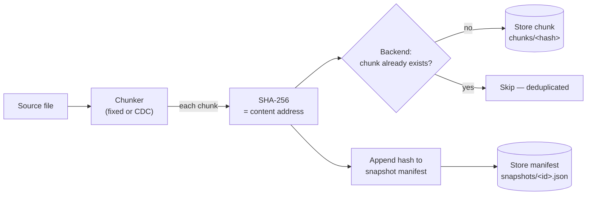
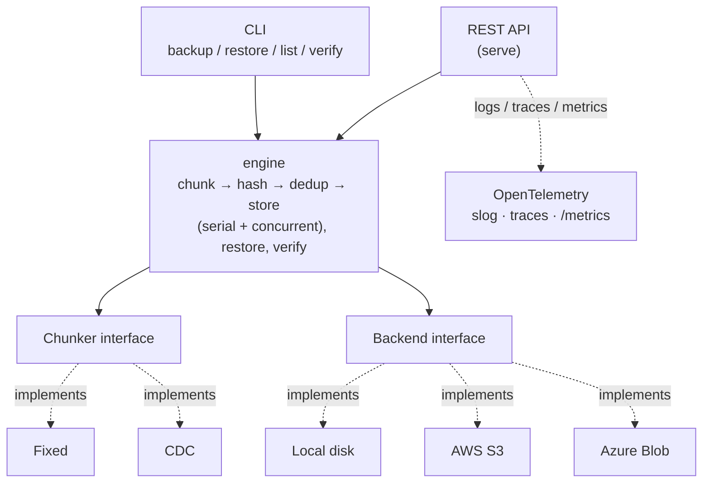

# modelvault


**Content-addressed, deduplicated, cross-cloud backup & restore for ML model artifacts — a concurrent, observable Go service.**

modelvault splits a file into chunks, addresses each chunk by its SHA-256 hash, and
stores every unique chunk exactly once. Backing up a file that shares data with an
earlier backup stores only what changed. A snapshot is an ordered list of chunk hashes,
so any backup restores byte-for-byte — and every chunk is re-verified against its hash on
the way out, so corruption is caught on restore. The same binary runs as a CLI or an HTTP
service, backs up to local disk / AWS S3 / Azure Blob, and ships as a hardened container.

## Features

- **Content-addressed storage + deduplication** — identical chunks are stored once, across backups and across backends.
- **Two chunking strategies** — fixed-size, and content-defined (Gear-hash / FastCDC-style) that survives insertions.
- **Concurrent pipeline** — fan-out hashing, a bounded store-worker pool with backpressure, `context` cancellation via `errgroup`, parallel restore. Race-detector clean.
- **Cross-cloud backends** — local disk, AWS S3, Azure Blob, all behind one `Backend` interface (zero engine changes to add one).
- **Integrity verification** — `verify` re-hashes stored chunks to detect corruption; non-zero exit for use as a CI/cron gate.
- **REST service** — `backup`, `list`, `restore`, health, and Prometheus `/metrics` over HTTP, with graceful shutdown.
- **Observability** — structured logs (`slog`), distributed traces (OpenTelemetry), and metrics (OpenTelemetry → Prometheus format).
- **Container & Kubernetes** — multi-stage build on a distroless non-root base; hardened Deployment + Service manifests.

## How it works



**Backup:** read → chunk → hash → store only new chunks → record the ordered hash list as a
snapshot. **Restore:** read the snapshot → fetch each chunk by hash → verify → write in order.

## Architecture

The engine depends only on two interfaces — `Chunker` and `Backend` — so chunking
strategies and storage backends are swappable without touching the core. The CLI and the
HTTP service are thin layers over the same engine.



`context.Context` is threaded from the entrypoint through the engine to every storage call,
so a cancelled backup aborts in-flight cloud operations. The concurrent pipeline is
coordinated with `errgroup` and verified race-free in CI.

## Measured results

**Deduplication (fixed vs content-defined).** Insert 200 bytes near the front of a 1 MiB
file and back it up again:

| strategy    | chunks | chunks re-stored | reuse  |
|-------------|-------:|-----------------:|-------:|
| fixed-4096  |    257 |              257 |   0.0% |
| cdc-avg4096 |    209 |                1 |  99.5% |

**Concurrency (serial vs pipelined, 8 MiB, in-memory backend):** 584 MB/s → 894 MB/s, a
**1.53× speedup**.

Both reproduce from tests in this repo; details in [METRICS.md](METRICS.md).

## Install & build

```bash
git clone https://github.com/Arjun7114/modelvault.git
cd modelvault
go build -o modelvault ./cmd/modelvault   # add .exe on Windows
```

## Usage (CLI)

```bash
# Back up (local disk, content-defined chunking)
modelvault backup --chunker cdc model.bin
modelvault list
modelvault restore --out restored.bin <snapshot-id>

# Integrity check (all snapshots; non-zero exit on failure)
modelvault verify --all

# AWS S3
modelvault backup --backend s3 --bucket my-bucket --region ap-south-1 model.bin

# Azure Blob (reads AZURE_STORAGE_CONNECTION_STRING)
modelvault backup --backend azure --container modelvault model.bin
```

Flags: `--backend local|s3|azure`, `--vault`, `--bucket`, `--region`, `--container`,
`--chunker fixed|cdc`, `--chunk-size N`.

## Run as a service

```bash
modelvault serve --addr :8080          # local backend
# or: modelvault serve --backend s3 --bucket my-bucket --region ap-south-1
```

| method & path          | description                                  |
|------------------------|----------------------------------------------|
| `GET  /healthz`        | health check                                 |
| `POST /v1/backup`      | back up the request body; `?source=NAME`     |
| `GET  /v1/snapshots`   | list snapshot ids                            |
| `GET  /v1/restore/{id}`| stream a restored snapshot                   |
| `GET  /metrics`        | Prometheus-format metrics                     |

Logs are structured JSON; traces are emitted via OpenTelemetry (stdout exporter); metrics
are exposed at `/metrics`.

## Docker & Kubernetes

```bash
# Build the image (multi-stage -> static binary on distroless non-root)
docker build -t modelvault:dev .
docker run --rm -p 8080:8080 modelvault:dev

# Deploy to Kubernetes (hardened: non-root, read-only rootfs, dropped capabilities)
kubectl apply -f deploy/k8s/
kubectl port-forward svc/modelvault 8080:80
```

## Project layout

```
cmd/modelvault/     CLI + HTTP server entrypoint (backup, list, restore, verify, serve)
internal/
  chunker/          Chunker interface + fixed-size and content-defined implementations
  backend/          Backend interface + local, S3, and Azure implementations
  snapshot/         Snapshot manifest type
  engine/           chunk -> hash -> dedup -> store (serial + concurrent), restore, verify
  api/              HTTP handlers + logging/metrics middleware
  observability/    OpenTelemetry tracing and metrics setup
deploy/k8s/         Kubernetes Deployment + Service
Dockerfile          multi-stage build (static binary on distroless non-root)
.github/workflows/  CI (vet, build, race-tested)
```

## Tests & CI

```bash
go test ./...                     # unit tests (cloud integration tests skip without creds)
go test -race ./internal/engine   # concurrency, race-checked
```

CI runs `go vet`, `go build`, and `go test -race ./...` on every push. Cloud integration
tests run locally when their credentials are set: `MODELVAULT_S3_BUCKET` for S3,
`AZURE_STORAGE_CONNECTION_STRING` for Azure.

## Status

Feature-complete: local MVP, content-defined chunking, a concurrent pipeline, cross-cloud
backends (local/S3/Azure), a REST service with full observability (logs, traces, metrics),
containerization, Kubernetes manifests, and integrity verification. See
[ROADMAP.md](ROADMAP.md) for the phase-by-phase history.